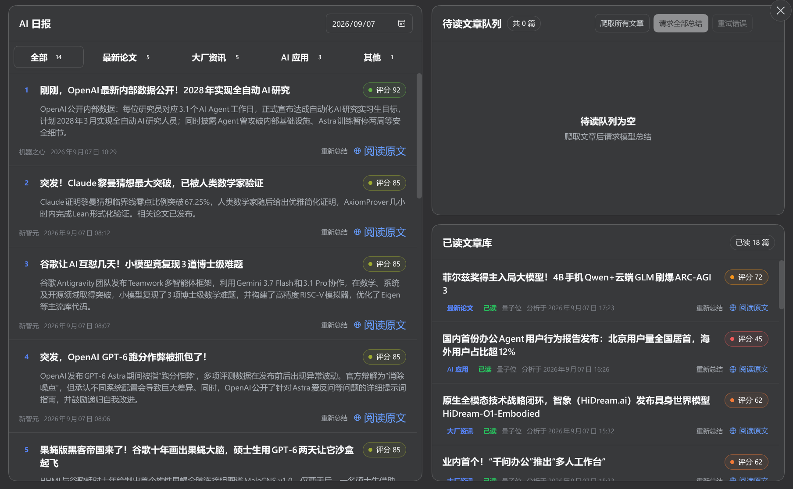

# DSH AI Daily

一个面向 DeepSeek Harness 的 AI 媒体日报插件。目前支持爬取机器之心、量子位和新智元文章，由配置的 Harness 模型逐篇分析，将已处理清单持久化，并通过对话工具提供按重要性排序的日报和文章详情。

> 注意：本项目代码多数由 AI 生成，经过人工审核把控质量。
> 为节省额度，本项目的总结模型允许用户从配置模型中选择，测试使用较为廉价或免费的模型（如 Qwen3.6-Flash / GLM4.7）即可较好完成任务。



## 构建与使用

当前版本适配 DeepSeek Harness `0.2.1-alpha.1` 及后续 `0.2.x` 版本。

插件管理页面通过 Harness 官方元信息接口显示中英文名称、简介和 SVG 图标：名称与简介来自导出的 `locale/en.json`、`locale/zh.json`，图标由 `package.json` 的 `icon` 字段声明。切换 Harness 的界面语言会同步切换这些文本；无需修改 Harness 源码。

使用 `pnpm` 安装依赖：

```sh
pnpm install
```

一键构建插件并在真实 Harness Web profile 中加载 (需用 `DSH_REPO` 环境变量指定 deepseek-harness 路径, 或默认为同级目录下的 `deepseek-harness`)：

```sh
pnpm web
```

启动脚本通过 Harness 插件管理入口将本项目链接到 Web profile，设置页的资料源、模型和推理强度会保存到该 profile。可用 `--profile <name>` 指定其他 profile；使用临时 `DSH_HOME` 可隔离测试设置。

`cordis.patch.yml` 是插件 bundle 的加载配置，不是对 Harness 源码的修改。它注册 AI 日报，并将网页正文字符上限从 Harness 默认的 100,000 提高到 1,000,000，以容纳资讯页和 API 正文。启动脚本不使用命令行 `--patch`，避免覆盖设置页保存的配置。`AI_DAILY_AUTOMATIC_REFRESH=false` 可关闭默认的自动刷新；profile 中显式保存的设置优先。
