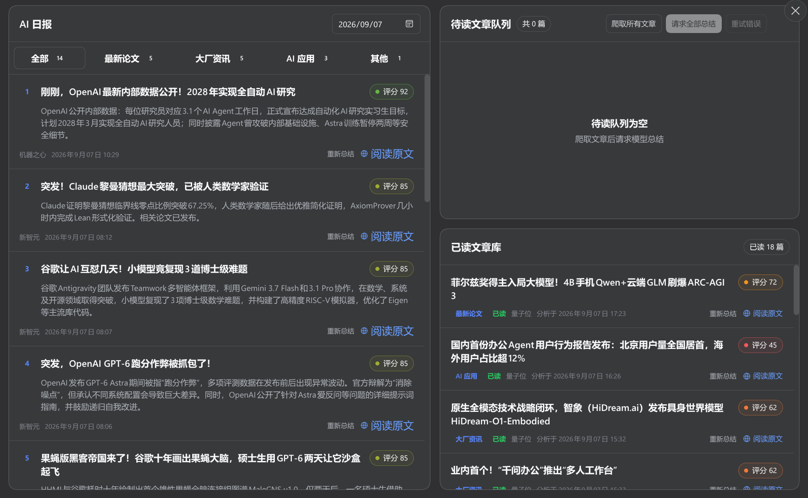

# DSH AI Daily

一个面向 DeepSeek Harness 的 AI 媒体日报插件。目前支持爬取机器之心、量子位和新智元文章，由配置的 Harness 模型逐篇分析，将已处理清单持久化，并通过对话工具提供按重要性排序的日报和文章详情。

> 注意：本项目代码多数由 AI 生成，经过人工审核把控质量。
> 为节省额度，本项目的总结模型允许用户从配置模型中选择，测试使用较为廉价或免费的模型（如 Qwen3.6-Flash / GLM4.7）即可较好完成任务。



## 构建与使用

当前版本适配 DeepSeek Harness `0.2.1-rc.2`，依赖范围为 `>=0.2.1-rc.2 <0.3.0`；后续版本仍需验证接口兼容性。

日报接口使用 Harness 的单条 HTTP 路由注册接口，由 Harness 统一执行浏览器认证及 owner 权限检查；非 owner 调用者不能访问本地文章库或触发资讯分析。

插件管理页面通过 Harness 官方元信息接口显示中英文名称、简介和 SVG 图标：名称与简介来自导出的 `locale/en.json`、`locale/zh.json`，图标由 `package.json` 的 `icon` 字段声明。切换 Harness 的界面语言会同步切换这些文本；无需修改 Harness 源码。

使用 `pnpm` 安装依赖：

```sh
pnpm install
```

一键构建插件并在真实 Harness Web profile 中加载 (需用 `DSH_REPO` 环境变量指定 deepseek-harness 路径, 或默认为同级目录下的 `deepseek-harness`)：

```sh
pnpm web
```

启动脚本通过 Harness 插件管理入口将本项目链接到 Web profile，设置页的资料源、模型和推理强度会保存到该 profile。可用 `--profile <name>` 指定其他 profile；使用临时 `DSH_HOME` 可隔离测试设置。

`cordis.patch.yml` 是插件 bundle 的加载配置，不是对 Harness 源码的修改。它注册 AI 日报，并将网页正文字符上限从 Harness 默认的 100,000 提高到 1,000,000，以容纳资讯页和 API 正文。启动脚本不使用命令行 `--patch`，避免覆盖设置页保存的配置。`AI_DAILY_AUTOMATIC_REFRESH=false` 可关闭默认的自动刷新；profile 中显式保存的设置优先。

## 联网核验

在“设置 → AI 日报”中启用“联网搜索”，即可允许所选阅读模型自行生成搜索词、选择搜索结果中的网页，并通过多轮工具调用继续分析；默认关闭。模型与推理强度仍使用日报所选路由，搜索与网页抓取使用 Harness 当前配置的 Web provider，搜索的密钥和 Endpoint 与阅读模型独立配置；本插件不会更改它们。搜索服务可能产生额外费用，多轮阅读也会增加模型用量。

开关自动保存，从下一次分析任务生效；正在处理的任务保持原有设置。爬取文章不会触发模型或搜索，已读文章不会因切换开关自动重读；可通过“重新总结”主动核验已有文章。文章行内显示搜索与网页读取进度，Harness 日志记录请求的搜索词、实际来源链接及失败原因。

搜索服务不可用时，该文章保留在失败队列中，修复 Harness 的 Web search 配置后可显式重试；无法打开的单个网页作为工具错误返回模型，允许在剩余预算内改用其他来源，不会伪装成读取成功。请求沿用原有文章总超时，并受以下插件配置限制：

| 配置项 | 默认值 | 含义 |
| --- | --- | --- |
| `webSearchEnabled` | `false` | 允许阅读模型调用搜索和网页抓取工具 |
| `maxResearchCalls` | `6` | 每篇文章合计的搜索/抓取尝试次数，含无效及失败调用 |
| `maxSearchResults` | `10` | 每次搜索最多返回的来源数，可设为 1–50 |
| `maxResearchChars` | `12000` | 单次结果的参考正文或搜索摘要字符上限 |
